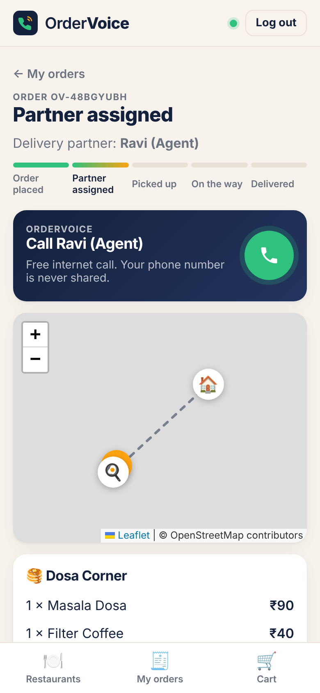
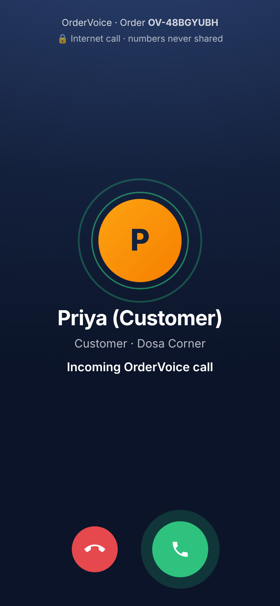
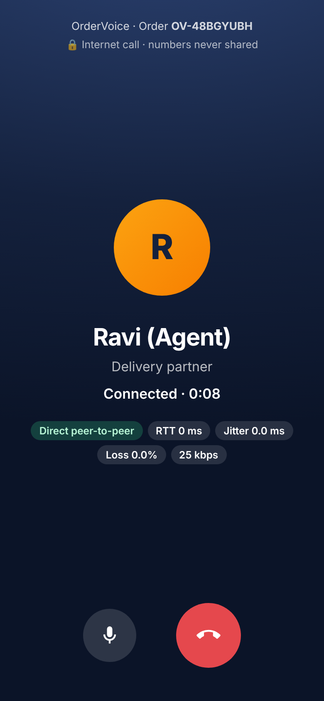
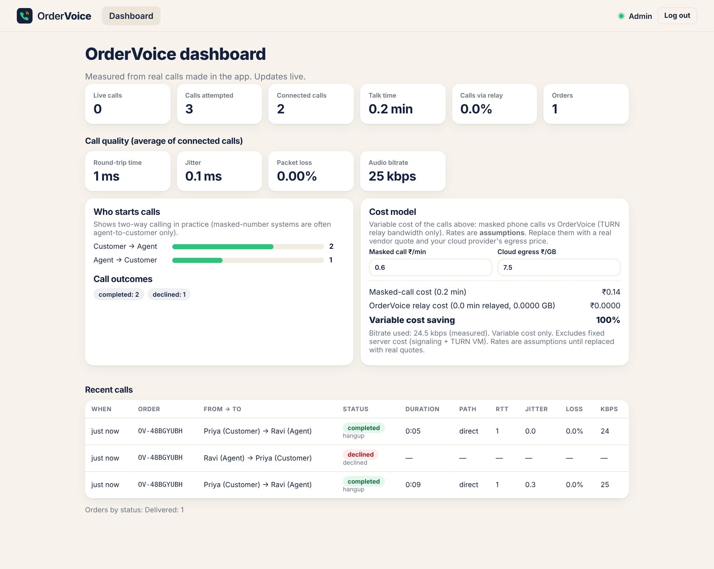
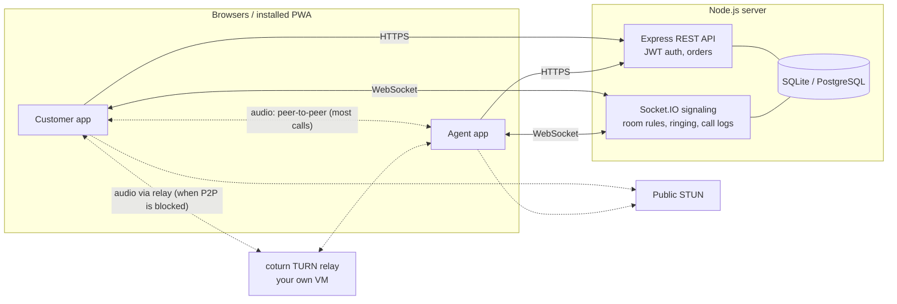
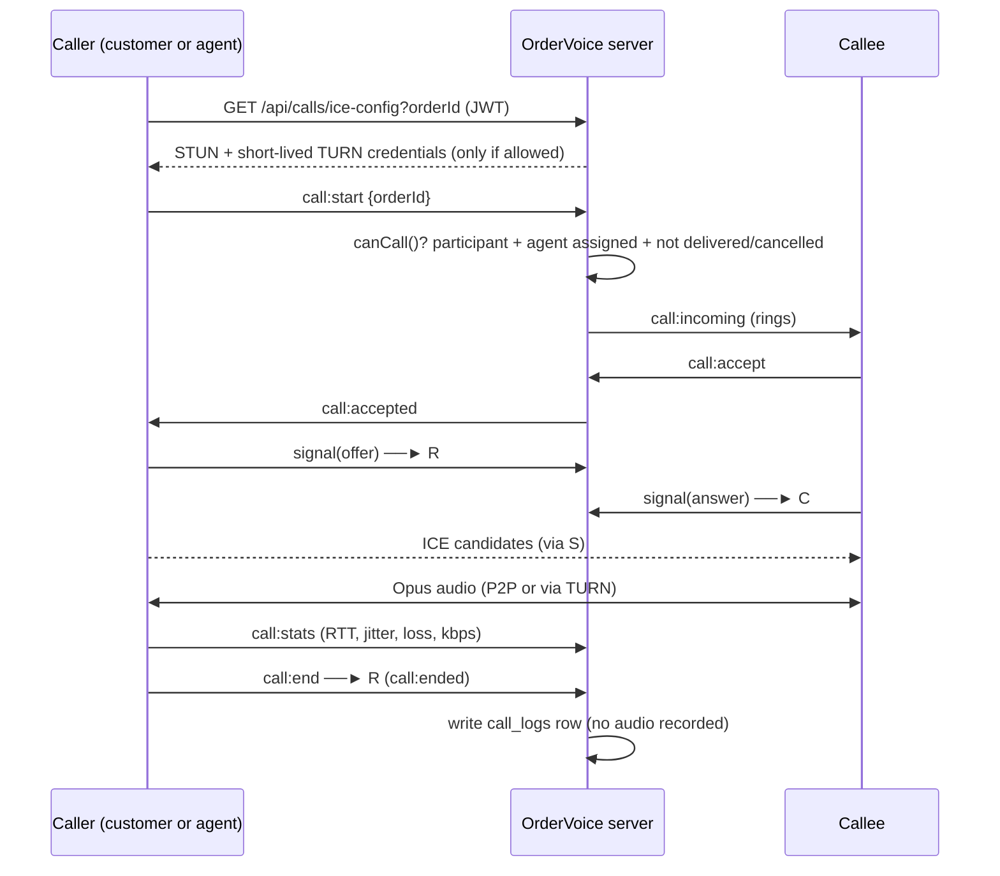

# OrderVoice

**A food delivery app where the customer and delivery partner call each other for free over the internet, using only the Order ID. No phone numbers are shared.**

| Customer: tracking | Partner: incoming call | In call | Internet lost |
|---|---|---|---|
|  |  |  |  |



**Quick start (Windows):** double-click `start-online.bat` → open the `https://….trycloudflare.com` link it prints on two phones. Details in [section 5](#5-run-it-locally) and [section 7](#7-deploy-and-share-online).

---

## 1. The problem

On delivery apps (Swiggy, Zomato, Zepto…), agent-customer calls go through a paid **number-masking** service such as Exotel: a virtual number bridges an ordinary phone call so neither side sees the other's number.

1. **Cost:** the platform pays for every minute (Indian providers publish about ₹0.5–1.5 per masked minute, plus monthly number rental). India has roughly 4.8 million food orders a day across Swiggy and Zomato.
2. **Leaks still happen:** masking only works if people always call through the app. Calling back from the phone's call history, or saving the number, exposes it.
3. **Privacy and safety:** the real numbers are still stored and passed to a vendor, and a delivery partner's personal number ends up with hundreds of strangers.

Free in-app internet calling already exists in ride-hailing (Uber added it in 2018), but there is no open design for food delivery. OrderVoice is one.

## 2. The solution

When a delivery partner accepts an order, OrderVoice opens a **private call room for that order**. Either side taps **Call** and they talk over the internet (WebRTC, the same technology behind WhatsApp/Meet calls). **As soon as the order is delivered (or cancelled), the room closes**: the Call button disappears for both sides and any call in progress is ended.

| Part | What it does |
|---|---|
| **Customer app** | Browse restaurants, cart, place order, live tracking on map, call the agent, call history |
| **Agent app** | Real-time new-order feed, accept order, update status, share live location (GPS or demo route), call the customer |
| **Admin dashboard** | Live call stats, measured call quality (RTT, jitter, loss, bitrate), relay %, cost model |
| **Backend** | REST API (orders, users, JWT login), SQLite/PostgreSQL |
| **OrderVoice call system** | Socket.IO signaling, order-scoped room authorization, ringing (in app or by Web Push when the app is closed), WebRTC peer-to-peer audio, TURN relay support, internet-off detection, call logs |
| **Maps** | GPS address at checkout, live partner location and road route, turn-by-turn navigation (OpenStreetMap: Nominatim + OSRM) |

## 3. Architecture



The server **never carries audio**. It only checks permissions, rings the other person and passes WebRTC setup messages. Audio goes directly between the two phones, or through the TURN relay when a network (strict NAT, some mobile carriers) blocks a direct path.

### Call sequence



### Call room rules (`server/src/policy.js`)

| Order state | Room |
|---|---|
| `placed` (no agent yet) | Closed: "Calling opens once a partner accepts" |
| `accepted` / `picked_up` / `out_for_delivery` | **Open** |
| `delivered` | **Closed immediately**; a live call is ended. (Optional: set `CALL_GRACE_MINUTES` > 0 to allow a few minutes after delivery.) |
| `cancelled` | Closed immediately; a live call is ended |

Only the order's **customer** and its **assigned agent** can call. **Knowing the Order ID is not enough:** every request is checked against the logged-in user (JWT). Order IDs are also random (`OV-7K3P9QXM`), not sequential.

## 3b. When someone's internet is off: normal (masked) call option

Internet calls (WebRTC) need **both** phones online. OrderVoice detects when they're not and tells the user clearly:

| Situation | What the app does |
|---|---|
| Other person is **offline** when you call | Call ends at once: *"Ravi's internet is off"* → **Normal call** button |
| Other person **loses internet while ringing** | Caller is told immediately (not after the ring timeout): *"Ravi's internet went off while ringing"* |
| Other person **loses internet mid-call** | Call is terminated: *"Internet connection lost on Ravi's side"* → **Normal call** button |
| **Your own** internet is off | Call card says *"You're offline"*; tapping Call shows the helpline option |

**Normal call** = a regular phone call through a **number-masking provider** (e.g. Exotel, which Swiggy uses). Swiggy-style one-click call: the server asks the provider to connect the order's two parties; the provider rings both phones from a virtual number, so neither sees the other's real number; it works even when one side has no internet; it's billed per minute.

In this prototype the provider is **not connected** (that needs a business account, Indian KYC and per-minute billing), so tapping *Normal call* **does not place a call**. It shows a screen explaining step by step how the provider would connect it, and logs the request. The admin dashboard counts **internet-off events** and **normal-call requests**, which shows how often a paid masked call would be needed.

Offline detection: Socket.IO heartbeat (8 s interval, 7 s timeout) on the server; WebRTC `connectionState` on the device (a call that stays `disconnected` for 6 s is ended as *peer offline*).

## 3c. Restaurants (Harohalli)

The app is set in **Harohalli** (Bengaluru South district, 562112), centred on 12.679863, 77.469299. The 8 restaurants are real eateries found in public listings (Justdial, Trip.com, SquareYards, 99acres): Vaibhoga Family Restaurant, Idly Mane, Ramanna Dum Biriyani, Green Chilli Multicuisine, Hotel Sri Durga, Sri Krishna Sagar, Rs Grand Restaurant and Jayaram Breakfast Point.

- **Positions are approximate** (placed along Kanakapura Main Road near the town centre, because the listings give no coordinates). Edit `lat`/`lng` in `server/src/seed.js` if you know the exact spot.
- **Menus, prices, ratings and ETAs are sample data** for the demo, not the restaurants' real menus.
- Existing databases are upgraded automatically (seed version 2). Old orders stay valid.

## 3d. Turn-by-turn navigation for the delivery partner

**Start navigation** opens an in-app navigation screen that follows the partner's **live GPS**:

- **Next-turn banner** (*"Turn left onto Bus Stand Road"*, distance counting down), plus the turn after it.
- **Map follows the rider** with a direction arrow from their movement; the travelled part of the route turns grey. Drag to look around, then tap *Re-centre*.
- **Remaining time · distance · arrival clock** update as they move.
- **Off-route → re-route**: if the rider is more than 45 m off the route on two readings, a new route is fetched from where they are.
- **Arrival**: at the restaurant → *Picked up · start delivery* (navigation continues to the customer); at the customer → *Mark as delivered*.
- **Voice guidance** (🔊, uses the phone's built-in speech) and a **Google Maps** shortcut.
- Brief GPS dropouts (tunnels, indoors) don't stop sharing; only a denied permission does.
- **Demo route** drives the scooter to the *next* stop along real roads, so navigation can be shown without riding.

Turn instructions come from OSRM route steps (`server/src/nav.js`); position-on-route, distance-to-turn, off-route and arrival maths are in `client/src/lib/nav.js` (unit-tested).

## 3e. Ringing the phone when the app is closed (Web Push)

Incoming calls ring the phone even when OrderVoice is closed, the same way a messaging app's notifications work, using the **Web Push** standard (no separate native app needed):

1. The user taps **Turn on** (banner on Deliveries / order tracking, or *Account → Ring my phone when the app is closed*). The browser subscribes to its push service (Google FCM on Android Chrome, Apple on iPhone) and the app sends that subscription to our server.
2. When someone calls and the other person's app is **closed or in the background**, the server sends an encrypted, VAPID-signed push. The **service worker** (`client/public/sw.js`) wakes up and shows **"Priya is calling"** with **Answer / Decline**, a ringing vibration pattern, and the notification stays until handled.
3. **Answer** opens the app at the order and answers automatically. **Decline** declines without opening the app (signed one-time token). If nobody answers, the notification turns into **"Missed call"** and the caller is offered a normal call.
4. Order updates (*partner assigned*, *on the way*, *delivered*, *new order near you* for free partners) also arrive as notifications when the app isn't open.

| Platform | Works? |
|---|---|
| Android (Chrome, Edge, Samsung Internet) | Yes, even when the app/tab is closed |
| iPhone / iPad (iOS 16.4+) | Yes, after **Share → Add to Home Screen** and opening from the Home Screen |
| Laptop (Chrome / Edge / Firefox) | Yes, while the browser is running |

**Limits:** a web notification can ring and vibrate, but it can't show a full-screen incoming-call screen over the lock screen like WhatsApp; that needs a native app (Android ConnectionService / iOS CallKit + FCM/APNs VoIP push). Delivery also depends on the phone's battery saver not blocking the browser.

## 3f. Location, maps and live routes

| Feature | How it works |
|---|---|
| **Use my current location** (checkout) | Browser GPS → server asks **Nominatim** (OpenStreetMap) for the street address → the *Street & area* field fills in automatically. Add flat / floor / landmark. |
| **Map pin** | Tap the map or drag the 🏠 pin to the exact building; the address updates to match. |
| **Address search** | Type an area or landmark → pick from results (limited to India, biased to the restaurant's area). |
| **Delivery radius** | Orders need a map pin within `DELIVERY_RADIUS_KM` (30 km) of the restaurant; the distance is shown at checkout. |
| **Live route (customer)** | Road route from **OSRM** using the partner's live GPS: *partner → restaurant → you* before pickup, *partner → you* after. Shows distance, ETA and how fresh the location is. |
| **Agent screen** | GPS is shared automatically once location permission is granted. Shows *Next: Pickup at… / Drop at…* with distance + time, and a **Navigate** button that opens Google Maps turn-by-turn. |
| **Demo route** | For reviews: the scooter drives along the real road route from restaurant to customer (~90 s). |

All map services are free and keyless. Requests go through our server, which sends an identifying User-Agent, keeps to Nominatim's 1 request/second limit and caches results. If the routing service is unreachable, a dashed straight line with an estimated time is shown instead. Phones need **https** for GPS (see section 5).

## 4. Security & privacy design

- **No phone numbers anywhere.** Sign-up needs only name, email, password. The other party sees only a name.
- **Real accounts, no built-in users.** Passwords are hashed with bcrypt. Admin sign-up needs a secret code (`ADMIN_SIGNUP_CODE`), checked in constant time. Login checks the chosen role.
- **JWT auth** on REST and on the WebSocket connection itself.
- **Order-scoped authorization** for every call action (start, accept, signal, end). Signals from a third socket are dropped.
- **TURN credentials** are short-lived (HMAC, coturn REST scheme) and are only issued to someone allowed to call for that order right now, so random users can't use your relay.
- **Agents see only the area** of an order before accepting, and the full address after.
- **Anti-spam:** max 6 call attempts per user per order per 10 min; one call per order at a time; ring timeout 30 s.
- **Encryption:** WebRTC audio is always encrypted (DTLS-SRTP). Even the TURN relay can't listen.
- **No recording.** Only metadata is logged (who, when, duration, quality).

## 5. Run it locally

Needs **Node.js 22.13+** (Node 24 LTS recommended). Works on Windows, macOS and Linux with nothing to compile.

**Easiest (Windows):** double-click **`start-online.bat`**. It installs packages the first time, builds the app, starts the server and gives you a public HTTPS link for phones (see section 7). For development with hot reload:

```bash
npm run setup          # installs server, client and e2e packages

# terminal 1
npm run dev:server     # http://localhost:4000 (creates SQLite DB + demo data)

# terminal 2
npm run dev:client     # http://localhost:5173
```

Open **two browser windows** (one normal, one incognito so the logins don't clash) and **create accounts**. No accounts are built in.

| Role | How to get an account |
|---|---|
| **Customer** | Create account → choose **Customer** |
| **Delivery partner** | Create account → choose **Delivery partner** |
| **Admin** | Create account → choose **Admin** → enter the **admin code** |

**Admin code:** set `ADMIN_SIGNUP_CODE=your-secret` in `server/.env`. If you don't set it, the server prints a random code in the console at startup, valid for that run only. In production, admin sign-up is disabled unless you set it. This stops a random visitor from making themselves admin.

**Logging in:** choose the same role tab you signed up with (Customer / Delivery partner / Admin). If you pick the wrong tab, the app tells you which role the account belongs to.

### Demo script (for your review)

0. Create a **Customer** account in one window and a **Delivery partner** account in the other (and an **Admin** account with the admin code for step 7).
1. **Customer:** open a restaurant → add items → View cart → enter address → Place order. Note the **Call button is disabled** ("opens once a partner accepts").
2. **Agent:** the order appears instantly → **Accept**. The customer's screen updates live and the Call button turns green.
3. **Agent:** tap **▶ Demo route**. The scooter moves on the customer's map.
4. **Customer → Call.** The agent's screen rings → Accept → talk. Point out the chips: **Direct peer-to-peer**, RTT, jitter, loss, kbps.
5. **Agent → Call** the customer: *two-way calling*. Decline it to show the "declined" log.
6. Agent: Picked up → Start delivery → Mark delivered. The Call button turns off on **both** screens ("Order delivered: calling closed").
7. **Admin:** dashboard shows every call, quality averages, who started calls, and the cost model.

### Try it on real phones

Browsers allow the microphone only on `https://` or `localhost`. For phones on the same Wi-Fi:

```bash
npm --prefix client run dev:https     # https://<your-laptop-LAN-IP>:5173 (accept the self-signed warning)
```

Easier: run `start-online.bat` and open the `https://….trycloudflare.com` link on both phones (works on Wi-Fi and mobile data). On Android/iOS use "Add to Home screen" to install it like an app.

### Troubleshooting
- **No compiler needed:** the app uses Node's built-in SQLite (`node:sqlite`), so there are no native modules to build. If you see `needs Node.js 22.13 or newer`, update Node (Node 24 LTS recommended).
- **Mic doesn't work on phone:** you're on `http://` with an IP address. Use `dev:https` or a deployed HTTPS URL.
- **Call connects on Wi-Fi but not between Wi-Fi and 4G:** configure TURN (section 7). The free Metered Open Relay works without a server of your own.
- **`start-online.bat` shows no link:** wait 10–20 seconds; check the second window ("OrderVoice server") has no red errors. College Wi-Fi sometimes blocks tunnels; try a phone hotspot.
- **Phone doesn't ring when the app is closed:** turn on *Account → Ring my phone when the app is closed* again after every new tunnel link (each address needs its own permission).

## 6. Tests

```bash
npm test               # 34 server tests + 3 client navigation-maths tests (node:test, in-memory DB)
npm run test:e2e       # 2 real Chrome browsers make real WebRTC calls (see below)
node e2e/metrics.mjs   # measures call setup time, bitrate, data per minute (direct and via local coturn)
```

| Server suite | Covers | Tests |
|---|---|---|
| `api.test.js` | auth, full call flow, room closing on cancel/delivery, TURN credentials (coturn and hosted) | 7 |
| `policy.test.js` | call-room rules | 6 |
| `internet-off.test.js` | offline detection, mid-call drop, normal-call logging, no phone numbers | 4 |
| `push.test.js` | push encryption, subscriptions, ringing a closed app, decline, missed calls | 6 |
| `geo.test.js` | address lookup, search, routes, location rules | 5 |
| `nav.test.js` | turn-by-turn instruction text, route steps | 3 |
| `seed.test.js` | Harohalli restaurants, database upgrade | 3 |

The **end-to-end test** (`e2e/call-flow.mjs`) launches Chrome with a fake microphone and emulated GPS and checks the whole product: sign up (customer, agent, admin with code) → order with *Use my current location* → agent accepts → navigation follows moving GPS, re-routes when off route → customer calls agent → **audio bytes flowing both ways** → agent calls customer → decline → agent's app closed: **push rings and Answer joins the call** → delivery closes the call room → every internet-off case → admin dashboard. It saves screenshots to `e2e/screenshots/`.
**Relay path verified too:** `e2e/metrics.mjs` forces 5 calls through a local coturn server and checks that every one used the relay path (section 8). You can also run `RELAY=1 npm run test:e2e` against a server configured with TURN.

Chrome is found automatically on Windows, macOS and Linux; set `CHROME=/path/to/chrome` to use a different browser binary.

Sample run:
```
✓ customer signed up, logged out, wrong role tab refused, logged in as Customer
✓ delivery partner signed up
✓ checkout: "Use my current location" filled the address from GPS; pin on map; distance shown
✓ checkout: address search returns places to pick from
✓ order placed OV-EPL68JGH (call button disabled until an agent accepts)
✓ agent accepted; customer screen updated live and call button enabled
✓ both maps fit restaurant, delivery pin and partner in view
✓ agent GPS auto-shared; agent sees route + Navigate; customer sees "Ravi is heading to the restaurant" with distance + ETA
✓ navigation follows GPS: "Turn left onto Harohalli Bus Stand Road" 660 m -> 130 m
✓ after the turn, the next instruction switches to "Arrive at your destination"
✓ agent left the route -> navigation re-routed from the new position
✓ arrived at restaurant -> "Picked up · start delivery" -> navigation now guides to the customer; customer sees "On the way"
✓ agent phone is ringing (incoming call screen)
✓ WebRTC connected on both sides
✓ audio flowing both ways: agent hears 25 kbps, customer hears 24 kbps · path: Direct peer-to-peer
✓ customer hung up; agent saw "Call ended"
✓ agent called customer (two-way calling); customer declined
✓ app closed -> phone rings by Web Push: "Priya Sharma is calling" [Answer | Decline], stays until answered, vibrates
✓ tapped "Answer" -> app opened, call auto-answered and connected; notification cleared
✓ order delivered; call button disabled for both customer and agent
✓ agent lost internet mid-call: call terminated, customer told "Internet connection lost on Ravi's side"
✓ "Normal call" shows how the masking provider connects the call (no demo call placed)
✓ agent's app closed + no answer: phone rung by push, then "Ravi didn't pick up" + normal call option; "missed call" push sent
✓ agent offline without call alerts: "Ravi's internet is off" immediately
✓ customer offline: tapping Call shows the helpline (normal call) option; back online afterwards
✓ admin: internet-off events and normal-call requests counted
✓ wrong admin code refused; admin signed up; dashboard shows 9 calls with quality metrics
ALL E2E CHECKS PASSED
```

## 7. Deploy and share online

### Free, no card: online from your laptop (Cloudflare Quick Tunnel)
Double-click **`start-online.bat`** (Windows). It builds the app, starts the server, downloads `cloudflared` once into `tools\`, and prints a public link like `https://random-words.trycloudflare.com`. That link works on any phone over Wi-Fi or mobile data, with valid HTTPS (mic, GPS and call alerts all work), for as long as the laptop and both windows stay open. No account or card is needed.

- The link changes every time you start it. Users log in again, and turn call alerts on again, on the new link. Accounts and orders stay in the laptop's database.
- For calls between Wi-Fi and 4G, add a free hosted TURN relay (20 GB/month): sign up at [Metered Open Relay](https://www.metered.ca/tools/openrelay/), open **TURN Server → Add Credential → Show ICE Servers Array**, and put the values in `server/.env`:

```ini
TURN_URLS=turn:standard.relay.metered.ca:80,turn:standard.relay.metered.ca:80?transport=tcp,turn:standard.relay.metered.ca:443,turns:standard.relay.metered.ca:443?transport=tcp
TURN_USERNAME=your-metered-username
TURN_PASSWORD=your-metered-password
```
`TURN_SECRET` (own coturn) wins if both are set. Never commit `server/.env`.

### Option A: one free VM on Oracle Cloud (needs a card for verification; includes your own TURN server)
**Step-by-step guide: [`deploy/ORACLE-DEPLOY.md`](deploy/ORACLE-DEPLOY.md)**

In short: create an Ubuntu VM, open ports **80, 443** (web), **3478 TCP+UDP** (TURN) and **49160-49200 UDP** (relay range) in the cloud firewall, point a free DuckDNS name at the VM, upload the project and run:

```bash
sudo bash deploy/oracle-setup.sh your-name.duckdns.org
```

The script opens the VM firewall, installs Docker, generates `deploy/.env` (JWT secret, admin code, TURN secret) and `deploy/turnserver.conf`, then starts the app, **Caddy** (automatic HTTPS) and **coturn** with `deploy/docker-compose.yml`. The database and push keys live in the `ordervoice-data` Docker volume. Running the script again rebuilds the app and keeps all secrets and data.
It works on any Ubuntu VM (AWS, GCP, DigitalOcean), not only Oracle.

### Option B: PaaS for the app + VM for TURN
Deploy the `Dockerfile` to Render/Railway/Fly.io (they give you HTTPS automatically), and run only `coturn` on a small VM. Note that free PaaS disks are often wiped on restart. Use PostgreSQL (`DATABASE_URL`) there.

### Verify TURN works
Open the app with `?relay=1` (e.g. `https://yourdomain.com/login?relay=1`). This forces calls through TURN, and the call screen should show **"Via relay (TURN)"**. Use `?relay=0` to switch back. You can also run `RELAY=1 npm run test:e2e` against a server configured with TURN.

### PostgreSQL
`npm --prefix server i pg`, then set `DATABASE_URL=postgres://…`. Tables are created automatically. All SQL goes through `server/src/db.js`, which supports both engines.

## 8. Measuring results (for your report)

### Measured with `e2e/metrics.mjs`
5 direct calls and 5 calls forced through a local coturn relay, 15 s of audio each, plus 200 requests per API endpoint. Both browsers ran on one computer, so this shows what the **software** needs; a 4G network adds its own delay.

| Measure | Direct | Through TURN |
|---|---|---|
| Call → other phone rings | 115 ms | 118 ms |
| Answer → connected | **101 ms** | **212 ms** |
| Audio (Opus) | 24.9 kbps | 24.5 kbps |
| On the wire, one direction | 44 kbps | 44 kbps |
| Data per minute, both directions | **0.66 MB** | 0.65 MB |
| Packet loss | 0% | 0% |

API response times averaged 1.4–1.6 ms (restaurants, order details, ICE config). Raw numbers are written to `e2e/metrics.json`.

### Per-call data in the app
The dashboard and the `call_logs` table hold **measured** data for every call:

| Column | Meaning |
|---|---|
| `connection_type` | `direct` (P2P) or `relay` (through TURN) |
| `avg_rtt_ms` | Round-trip time (latency) |
| `jitter_ms` | Variation in packet arrival |
| `packet_loss_pct` | % of audio packets lost |
| `bitrate_kbps` | Audio bitrate actually received |
| `duration_sec`, `status`, `caller_role` | Talk time, outcome, who called |

**Suggested experiment:** make about 20 calls across conditions (same Wi-Fi; Wi-Fi ↔ 4G; 4G ↔ 4G on different carriers; forced relay) and record the table. Report the averages, the % of calls that needed relay, and quality per condition.

**Cost model (admin dashboard):**
```
masked-call cost  = total talk minutes × vendor ₹/min
OrderVoice cost   = relayed minutes × (bitrate × 60 / 8 / 10^9 GB/min) × 2 streams × cloud ₹/GB
saving            = 1 − OrderVoice cost / masked-call cost
```
Direct P2P minutes cost ₹0 in bandwidth. The default rates are **placeholders**: replace them with a real vendor quote and your cloud provider's egress price. Also mention the **fixed** monthly cost of the VM(s), which this variable-cost formula leaves out.

## 9. Honest limits & future work

- **The saving figure is an estimate** from the formula above, built on measured minutes and bitrate. It is not an audited production result.
- **Internet calls need both people online.** The app detects this and offers a normal (masked) call (section 3b), but the masking provider isn't connected in this prototype. **Future work:** connect Exotel's click-to-call / masking API so the *Normal call* button places a real masked call (only those minutes are paid). With no mobile signal at all, no call is possible.
- **Background ringing:** done with Web Push (section 3e): the phone rings via a notification when the app is closed. **Future work:** a native wrapper (Capacitor) with CallKit / ConnectionService for a full-screen lock-screen call UI.
- **Production relay:** use your own coturn server (config included), not a free public relay.
- **Scale:** active calls are tracked in one server's memory. **Future work:** a Socket.IO Redis adapter for multiple server instances, and load tests with thousands of calls.
- **Free map servers** (public Nominatim/OSRM) are shared and rate-limited; a large deployment needs its own.
- **Measurements** so far are from one machine; the next experiment is calls between phones on different mobile operators.
- Payments, restaurant-side app and ratings are out of scope (demo restaurants are seeded; user accounts are not).

## 10. Project structure

```
ordervoice/
├── server/                 Node.js backend
│   ├── src/
│   │   ├── index.js        entry point
│   │   ├── app.js          Express + Socket.IO wiring
│   │   ├── config.js       all settings (env vars)
│   │   ├── db.js           SQLite / PostgreSQL adapter + schema
│   │   ├── seed.js         demo restaurants (no user accounts)
│   │   ├── auth.js         JWT helpers + middleware
│   │   ├── policy.js       ★ call-room rules (who can call, when)
│   │   ├── signaling.js    ★ OrderVoice signaling server
│   │   ├── turn.js         ★ STUN/TURN config + short-lived credentials
│   │   ├── geo.js          address lookup/search (Nominatim) + road routes (OSRM)
│   │   ├── nav.js          turn-by-turn instruction text from route steps
│   │   ├── push.js         ★ Web Push: VAPID keys, subscriptions, ringing closed apps
│   │   ├── orders.js       order helpers / client view
│   │   └── routes/         auth, restaurants, orders, calls, admin
│   └── test/               API, policy, internet-off, push, geo, nav, seed tests
├── client/                 React (Vite) app: customer, agent and admin UIs
│   └── src/
│       ├── call/           ★ CallProvider (WebRTC), CallScreen, stats, tones
│       ├── components/     Layout, CallPanel, TrackMap (Leaflet/OSM), StatusSteps
│       ├── pages/          customer/, agent/, admin/, Login, Register
│       └── lib/            api, auth, socket, cart
├── e2e/
│   ├── call-flow.mjs       two-browser real-call end-to-end test
│   ├── metrics.mjs         call performance measurement (direct + TURN)
│   └── screens.mjs         screenshots of every page at phone/tablet/laptop size
├── start-online.bat        one-click: build, start, public HTTPS link (Cloudflare Quick Tunnel)
├── deploy/                 oracle-setup.sh, ORACLE-DEPLOY.md, docker-compose.yml, Caddyfile, turnserver.conf
├── docs/screenshots/
└── Dockerfile
```

## 11. API reference

| Method | Path | Who | Purpose |
|---|---|---|---|
| POST | `/api/auth/register` | public | `{name,email,password,role,adminCode?}` → token (admin needs code) |
| POST | `/api/auth/login` | public | `{email,password,role?}` → token (role must match) |
| GET | `/api/auth/me` | any | current user |
| GET | `/api/restaurants` | any | list |
| GET | `/api/restaurants/:id` | any | restaurant + menu |
| POST | `/api/orders` | customer | place order |
| GET | `/api/orders` | any | my orders |
| GET | `/api/orders/available` | agent | unassigned orders |
| GET | `/api/orders/:id` | participant/admin | order + `call.allowed` |
| POST | `/api/orders/:id/accept` | agent | atomic accept |
| POST | `/api/orders/:id/status` | assigned agent | next status |
| POST | `/api/orders/:id/cancel` | customer | before pickup |
| GET | `/api/orders/:id/calls` | participant/admin | call history |
| GET | `/api/calls/ice-config?orderId=` | participant | STUN/TURN servers |
| GET | `/api/admin/stats` | admin | metrics + cost model |
| GET | `/api/admin/calls` | admin | recent call logs |
| POST | `/api/calls/masked-request` | participant | log a normal (masked) call request `{orderId, reason}` |
| GET | `/api/push/public-key` | public | VAPID key for subscribing |
| POST | `/api/push/subscribe` · `/unsubscribe` · `/test` | any | manage this device's call alerts |
| POST | `/api/push/call-action` | signed token | Decline from the notification |
| GET | `/api/geo/reverse?lat=&lng=` | any | GPS → street address |
| GET | `/api/geo/search?q=&near=lat,lng` | any | address search |
| GET | `/api/geo/route?from=&via=&to=[&steps=1]` | any | road route, distance, duration (+ turn-by-turn steps) |

**Socket.IO events:** `call:start`, `call:incoming`, `call:accept`, `call:accepted`, `call:decline`, `call:end`, `call:ended`, `call:taken`, `signal`, `call:connected`, `call:stats`, `agent:location`, `order:last-location`, `order:update`, `orders:available-changed`, `admin:calls-changed`.

## Tech stack

React 19 + Vite · Node.js + Express · Socket.IO · WebRTC (Opus) · SQLite (built-in `node:sqlite`) / PostgreSQL · JWT + bcrypt · Leaflet + OpenStreetMap (Nominatim, OSRM) · Web Push (VAPID) · coturn / Metered Open Relay · Cloudflare Tunnel · Docker + Caddy

## Project

Major Project, Department of Computer Science and Engineering, School of Engineering, Dayananda Sagar University, Harohalli.